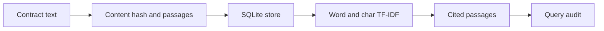

# Architecture and engineering decisions

> **Scope:** a local reference implementation using invented/synthetic inputs. No production deployment or service-level claims are implied.

## Citation-first local retrieval API

**Actual processing path:** HTTP ingestion --> Content hash --> Offset-preserving passages --> SQLite --> TF-IDF query ranking --> Cited hits and audit records.

## Key files

- `clauseledger/core.py`: ingestion, persistence, passage segmentation, search and rule signals.
- `clauseledger/api.py`: FastAPI endpoints and typed contracts.
- `clauseledger/evaluation.py`: deliberately small retrieval evaluation fixture.

## Failure modes / trust boundaries

No access control or tenant isolation. Index construction is performed per query. Clause signals are pattern flags, not legal determinations; do not upload private agreements.

## What I would build next

Persisted index, representative labelled evaluation set, access controls, indexing jobs and encryption.

## Reviewer checklist

1. Read the source and confirm the processing path above.
2. Follow `docs/DEMO.md` and run the tests locally.
3. Inspect CI and document any divergence between local and GitHub results.
4. Treat all benchmarks as synthetic demonstrations unless proven otherwise.
